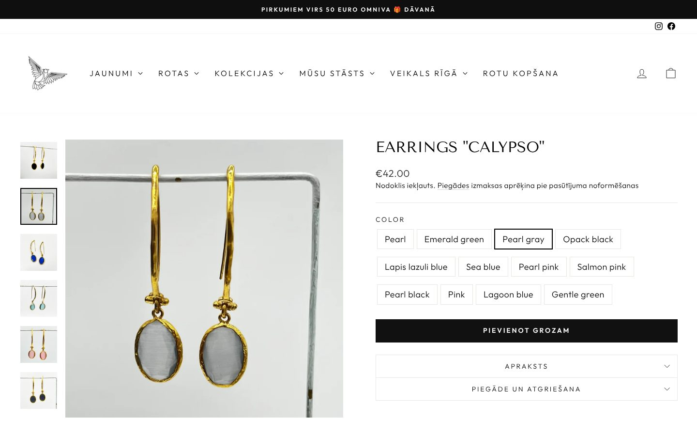
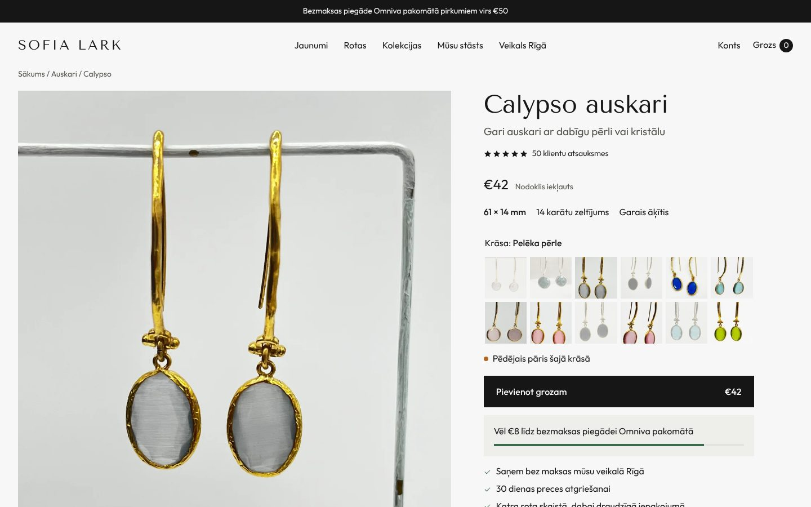
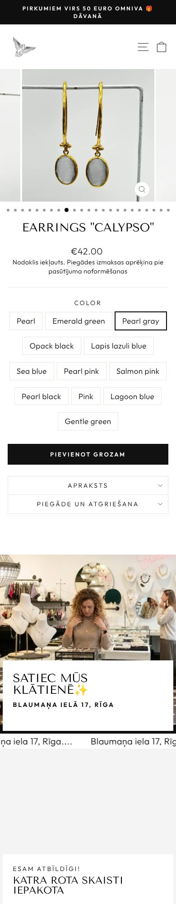
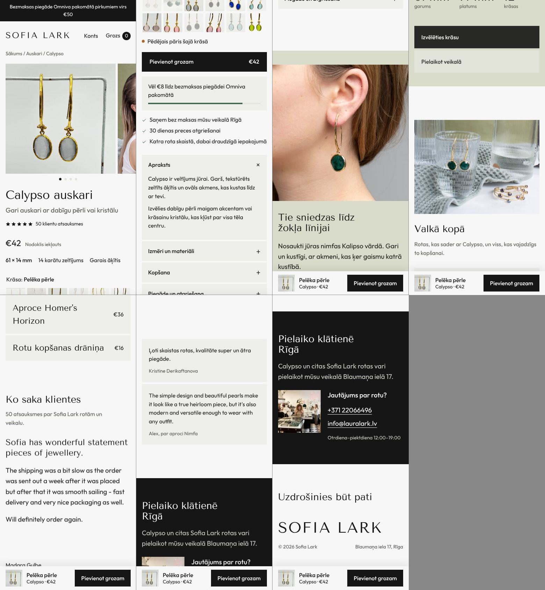

# Sofia Lark: product page analysis and new layout

Store: sofialark.com (Shopify, theme Impulse 9.0, 336 products, EUR, site language Latvian).
Sources: live Shopify Admin data for the product catalogue, and the live page `/products/earrings-calypso` rendered at 1440px and 390px.
Prototype: [`index.html`](index.html). Open it in a browser. It uses the real Calypso photos, prices and stock from Shopify.

| Before | After |
| --- | --- |
|  |  |
|  |  |

---

## 1. What a jewellery product page should show

Ordered by how much it affects the decision to buy. "Status" says where this information is today.

| # | Information | Why it sells | Status at Sofia Lark |
| --- | --- | --- | --- |
| 1 | Name and what it is ("Calypso auskari", plus one line) | The first five seconds | Shown, but as `EARRINGS "CALYPSO"`, all caps and in English |
| 2 | Price, tax included, and the price of the chosen variant | — | Shown |
| 3 | **Key facts above the fold**: size in mm, plating or metal, stone, closure | Jewellery is bought by scale and material | **Hidden.** Present in the description text only, behind a closed "Apraksts" tab |
| 4 | **Variant picker with a photo of each colour** | "Lagoon blue" and "Sea blue" mean nothing without a picture | **Hidden.** Every Calypso colour has its own variant photo, but the picker shows 12 text buttons |
| 5 | **Stock per variant** ("Last pair", "2 left", sold out) | Real scarcity, and it stops people trying to buy a sold-out colour | **Not shown.** Most colours have 1–2 pairs, and 5 of the 12 are sold out |
| 6 | **On-body photo for scale** | The biggest doubt with 61 mm earrings is how long they look | **Exists but is buried.** On-ear and model shots sit at positions 2–7 among 23 thumbnails |
| 7 | Free delivery threshold applied to this price ("€8 more for free delivery") | Raises basket size | Only in the announcement bar, never connected to the price |
| 8 | Free pickup in Rīga and 30-day returns (14 is the legal minimum) | Two strong reasons to trust the shop | **Hidden** inside a long legal text in "Piegāde un atgriešana" |
| 9 | Gift packaging | Much jewellery is bought as a gift | A section exists, but its image is broken (Liquid error), leaving a large empty block |
| 10 | Reviews: this product's, or the shop's if there are none | Social proof | Judge.me is installed, but only 5 products have a rating. The shop-wide carousel also shows non-reviews ("Parcel processing", "Iepakošana", a broken "Penelope's ring" image) and a lost-parcel complaint |
| 11 | Care instructions and the care product you sell | Answers "will it tarnish?" and adds €16 to the order | Written well on the new Kalliope products. Not linked to the care cloth |
| 12 | Complete the look (2–3 matching pieces) | Cross-sell | **Not used.** Shopify's `complementary_products` metafield is defined but unused, even though the lifestyle photos show Calypso with bracelets and rings |
| 13 | The story: collection and the meaning of the name | Products are named after Greek myths (Calypso, Siren, Euterpe, Niobe, Hestia) and Kalliope is handmade in Greece | Not shown. Older descriptions are generic marketing copy |
| 14 | The physical shop: address, hours, contact | A local boutique is a trust signal and a way to sell in person | Shown as "Blaumaņa iela 17, Rīga…." repeated 35 times in a scrolling marquee. Hours appear only in the footer |
| 15 | Back-in-stock alert on sold-out colours | Keeps demand | Missing |
| 16 | Water-resistant and hypoallergenic, for the steel ("moonc") range | Top objection for fashion jewellery | Only in description text ("Does not change color in contact with water") |

## 2. Information that exists but is broken or hidden

**Bugs visible on the live page**
- `Liquid error (snippets/product-template line 390): divided by 0`. Many variants store a compare-at price of `0.00` instead of empty (for example Calypso "Pearl", Ferns and Nimfa), and the theme's "you save X%" code divides by it. Fix: clear those compare-at prices.
- `Liquid error (snippets/image-element line 113): invalid url input`. The "Esam atbildīgi! Katra rota skaisti iepakota" section has no image set, which renders as a large empty grey or black block on desktop and on mobile.
- The spin-the-wheel popup opens over the buy box on product pages, at the moment of decision. Show it on the home or collection pages, or on exit intent, and not on product pages.

**Data that is wrong**
- `custom.material` is "Juveliertērauds" (stainless steel) on Calypso, Ferns and Nimfa, but their descriptions say gold-plated brass or bronze. This also makes the material filter wrong.
- `custom.color` holds "Yellow Gold" and `custom.earring_closure` holds "Stud". Neither is one of the allowed choices ("Zelta krāsā…", "Nagliņauskari / Angļu aizdare / Cilpiņa"). Calypso is also a long hook, not a stud.
- The Moonlit Arch Ring's SEO description is the Golden Ball Bar Ring's text.
- Images have empty alt text on the older products I sampled. That hurts accessibility and Google Images, which matters for jewellery.

**Content that needs a clean-up**
- Mixed languages on a Latvian site: English titles, descriptions and variant names on older products, Latvian on newer ones. Variant names include typos and placeholders ("Opack black", "Pearl with", "1", "2", "3", "SUDRABA"/"ZELTA").
- Title format: `Earrings "Calypso"` and all-caps titles. Better: "Calypso auskari".
- Description HTML contains pasted `<meta charset>` tags and empty paragraphs.
- Emoji in headings (✨, 🎁).
- Source images are 2,500–4,000px PNGs. Shopify resizes them, but JPG uploads would be much lighter.

## 3. The new layout

Designed using the **ui-ux-pro-max**, **taste-skill** and **tastemaker** skills:
- Brand type and colour are kept: Tenor Sans, Outfit, black and white.
- The sage green and glass tones come from Sofia Lark's own product photography.
- The composition is taste-skill's "split stage".
- One page, about 6.5 screens on desktop.

**First screen (left: photos scroll; right: the buy box stays in place)**
1. Title "Calypso auskari" plus one plain line: "Gari auskari ar dabīgu pērli vai kristālu".
2. Review link, price with tax note, and a key-facts line: **61 × 14 mm · 14 karātu zeltījums · Garais āķītis**.
3. **Stone tray:** all 12 colours as photo tiles cut from the real variant images. Choosing one changes the main photo and the price, and shows real stock ("Pēdējais pāris", "Palikuši 2 pāri", "Izpārdota"). Sold-out colours are greyed and the button becomes "Paziņot, kad atkal būs pieejams".
4. A full-width add-to-cart button that shows the price.
5. Free-delivery meter computed from the price: "Vēl €8 līdz bezmaksas piegādei".
6. Three promises as plain text: free pickup in Rīga, 30-day returns, gift packaging.
7. Four short tabs: Apraksts (open), Izmēri un materiāli, Kopšana, Piegāde un atgriešana. The full legal text moves to the policy page.

**Below, five short sections**
1. **Scale:** a large on-ear photo, "Tie sniedzas līdz žokļa līnijai", the Calypso myth in one line, 61 mm / 14 mm / 12 colours, and two actions.
2. **Valkā kopā:** the lifestyle photo with three real products: Nimfa bracelet €64, Homer's Horizon €36 and the care cloth €16. Hovering or tapping a row changes the photo to that product, and each row has its own add button. The €16 cloth takes a €42 Calypso over the €50 free-delivery threshold.
3. **Reviews:** one real customer letter set large, plus two short real quotes. The broken and non-review entries are left out.
4. **Visit the shop:** a photo, phone, email and hours.
5. **Footer:** the brand motto and the name at full width.

**On a phone**
- The gallery becomes a swipe carousel with dots.
- A sticky bar with the chosen colour, price and "Pievienot grozam" appears once the main button scrolls away.
- Adding to cart shows a confirmation with the updated delivery meter.

**Checks run**
- taste-skill `lint`: 0 FAIL. Its one warning flags Outfit as a default typeface; it is the brand's font and is kept on purpose.
- taste-skill `inspect` at 1440, 768 and 390px. It reports 1 FAIL and 2 warnings, all deliberate:
  - The FAIL is the phone sticky bar, which by design sits over content as it scrolls past. A copy without the bar passes with 0 FAIL.
  - The phone gallery scrolls sideways; that is the swipe pattern.
  - There is no video because Calypso has none. Some products, like the Moonlit Arch Ring, do have video and should show it second.
- A browser test of the colour picker, sold-out state, add-to-cart, delivery meter, cross-sell rows, keyboard arrows on the tray, and the phone sticky bar: no console errors and no sideways page scroll.

## 4. To confirm before this goes live

- **Latvian copy** in the prototype is my own wording. Please have a native speaker proofread the description, variant names (for example "Pelēka pērle", "Lagūnas zila", "Matēti melna") and section texts.
- **Closure:** the prototype says "Garais āķītis" based on the photos; Shopify currently says "Stud".
- **Base metal for Calypso:** the description says "gold-plated (14 carats)", but the material metafield says stainless steel. Which is right?
- **"Pearl gray"** in the photos looks like a grey cat's-eye stone rather than a pearl.
- **Shop rating:** the prototype says "50 klientu atsauksmes" (taken from the live widget) without claiming an average. Use Judge.me's real average when building it.
- **Back-in-stock alerts** need an app, for example Judge.me's or Shopify's back-in-stock apps. The prototype falls back to email.

## 5. Making it real in Impulse (suggested order)

1. **Data fixes, about one hour, no design work:**
   - Clear `0.00` compare-at prices.
   - Fix or remove the packaging-section image.
   - Correct the material, colour and closure metafields on the earring range.
   - Stop the wheel popup on product pages.
2. **Product metafields for the facts line and specs tab:**
   - `custom.length_mm` and `custom.width_mm` (number).
   - `custom.plating` (single line).
   - `custom.stone` (single line).
   - A corrected `custom.earring_closure`.
   - `custom.water_resistant` and `custom.hypoallergenic` (true/false, for the steel range).
   - Care text as a shared metaobject, so it is written once per material.
3. **Theme:**
   - Image variant swatches. Impulse 9 supports variant images on swatches through the theme editor or a small snippet change.
   - A stock message block, the delivery-meter block, the three promises block and the tabs from metafields.
   - Fill `complementary_products` for the "Valkā kopā" block.
4. **Content, gradually:** Latvian titles and variant names, alt text on images, and on-ear photos moved to position 2.
