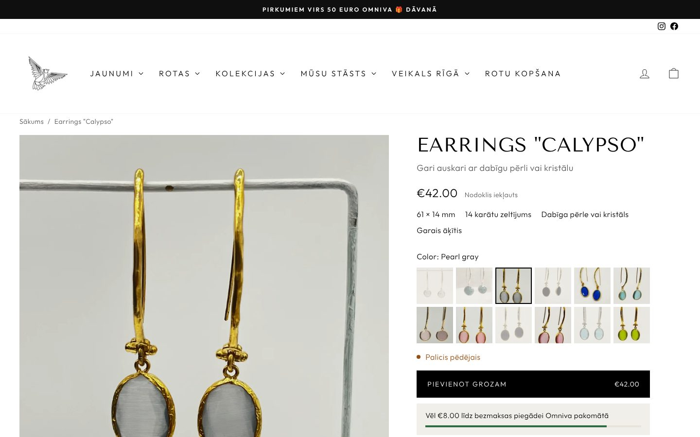
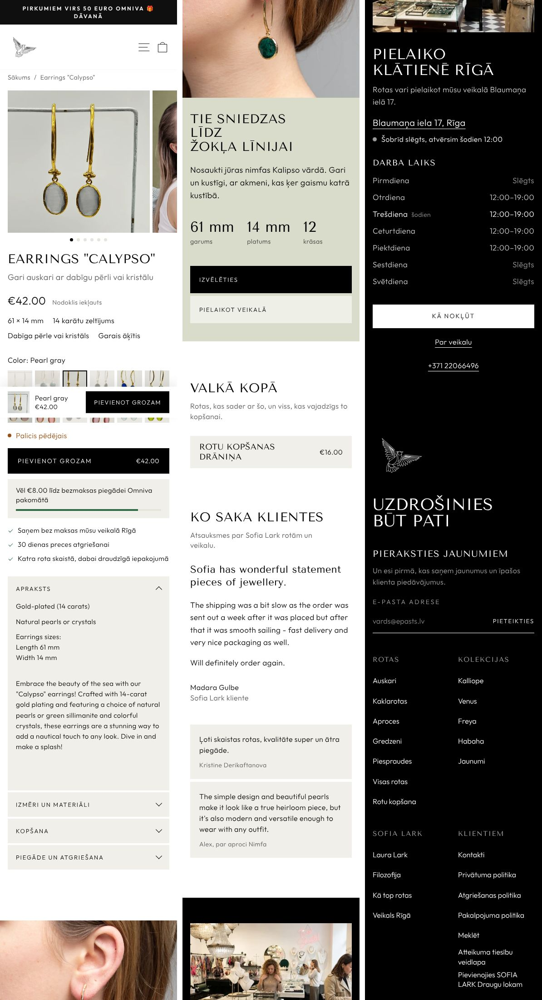
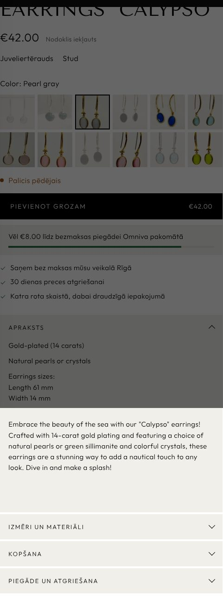

# Sofia Lark product page: theme sections

The product page layout from [`../product-page/`](../product-page/), built as sections for the store's Impulse 9 theme. They follow the theme's existing `sl-` sections:
- the same stone ground, black ink, Tenor capitals and Outfit body text;
- one stylesheet and one script per feature;
- Latvian copy, with settings labels in English.

| Desktop | Phone |
| --- | --- |
|  |  |

Screenshots are from the Calypso earrings. They use the real photos, prices and stock, and the proposed metafield values from section 3, rendered inside the live header and footer.

## What's here

| File | What it does |
| --- | --- |
| `sections/sl-product.liquid` | The product itself. Photographs scroll on the left while the buy box stays in place. The buy box holds: title and one-line subtitle, app blocks (for example Judge.me stars), price, key facts, colour tiles with stock, add to cart, the free-delivery meter, three promises, and tabs (description, size and materials, care, delivery and returns). On phones the gallery swipes and a bar with the colour, price and button appears after the main button scrolls away. |
| `sections/sl-product-scale.liquid` | "Tā izskatās valkājot": a large photo of the piece being worn, with its measurements. Hidden when the product has no such photo. |
| `sections/sl-product-pair.liquid` | "Valkā kopā": the product's complementary products (Search & Discovery app) or ones picked in the editor, then the care product. Each row can be added to the cart from the page. |
| `sections/sl-quote.liquid` | One real review set as a letter, plus up to three short ones. |
| `snippets/sl-pair-row.liquid` | One row of "Valkā kopā". |
| `assets/sl-product.css`, `assets/sl-product.js` | Styles and behaviour for all of the above. Without the script, the form still adds the chosen default variant to the cart. |
| `templates/product.sl.json` | An alternate product template using these sections plus the theme's existing `sl-store` section. |

The template is called `product.sl`, so **no live product changes until it's assigned to one**. In Shopify admin, open a product, go to *Theme template*, and choose `sl`.

## 1. Install

The files go into the existing theme, next to the other `sl-` files. None replaces an existing file.

1. Duplicate the live theme ("Impulse – fiksētā kartīte (draft)") under *Online Store → Themes*.
2. On the copy, choose *Edit code* and add the seven files under the same folder names.
3. Open the copy's theme editor on a product, switch the template to `sl`, and check it.
4. Assign the `sl` template to one product (Calypso), then to more as their metafields are filled in.
5. Publish the copy, or copy the same seven files into the live theme.

## 2. The cart

- The theme's cart type is currently **page**. With a page cart, adding a piece shows a short confirmation under the button ("… pievienots grozam · Uz grozu"), and the visitor stays on the page where "Valkā kopā" can do its job.
- If the theme's cart type is switched to **drawer** (*Theme settings → Cart*), the section uses the theme's own drawer instead. It sends the same `ajaxProduct:added` event the theme listens for.
- The header cart badge updates either way.

## 3. Metafields to create

These are under *Settings → Custom data → Products*, namespace `custom`. Every one is optional. Anything empty is simply left out of the page.

| Key | Type | Shown as | Calypso, for example |
| --- | --- | --- | --- |
| `subtitle` | Single line text | The line under the title | Gari auskari ar dabīgu pērli vai kristālu |
| `length_mm` | Integer | Key facts, size tab, worn section | 61 |
| `width_mm` | Integer | Key facts, size tab, worn section | 14 |
| `plating` | Single line text | Key facts (in place of material), size tab | 14 karātu zeltījums |
| `stone` | Single line text | Key facts, size tab | Dabīga pērle vai kristāls |
| `water_resistant` | True or false | "Ūdensizturīga" in key facts | (the steel range) |
| `hypoallergenic` | True or false | "Hipoalerģiska" in key facts | (the steel range) |
| `care` | Rich text | Care tab (else the section's text) | |
| `on_body_image` | File (image) | The worn section's photograph | the on-ear photo |
| `scale_heading` | Single line text | The worn section's heading | Tie sniedzas līdz žokļa līnijai |
| `story` | Multi-line text | The worn section's text | Nosaukti jūras nimfas Kalipso vārdā… |

**`material` and `earring_closure` already exist and are used as they are.** Fix them first. They currently say "Juveliertērauds" and "Stud" on Calypso, and with today's data that is what the key facts line shows:

"Valkā kopā" reads the Search & Discovery app's **complementary products**. Fill those for the pieces you want to sell together. Until then it shows only the care cloth, in a compact layout without the photo.

## 4. Settings worth knowing

The product section has these settings:
- Gallery length (default 6).
- Which option names become photo tiles (default "Color, Colour, Krāsa, Akmens").
- How far the tiles zoom in on the stone.
- From what number "Palikuši tikai [count]" appears.
- The free-delivery threshold (default €50; 0 hides the meter).
- The three promises.
- The care product.
- The delivery text and page.

All the visible wording is editable there too.

Sold-out variants offer "Paziņot, kad atkal būs pieejams", which opens an email to the shop. A back-in-stock app can take its place later.

## 5. How it was checked

- **Theme Check** (`shopify theme check`): 0 offenses.
- **Rendering and browser test:**
  - **Setup:**
    - The template was rendered with LiquidJS and Shopify-style filters, using each product's public storefront JSON.
    - The result was spliced into a saved copy of the live product page, so it ran with the real `theme.css`, `theme.js`, header and footer.
    - The cart endpoints were mocked.
  - **Products tested:**
    - Calypso (12 colours, 5 sold out).
    - A Kalliope product (Latvian "Krāsa" option, no metafields).
    - The Moonlit Arch Ring (one variant, a video).
    - Calypso with today's metafields.
    - Calypso with complementary products set.
  - **What was checked:**
    - Price, stock line and photo follow the chosen colour, and so does `?variant=`.
    - Sold-out colours disable the button and offer the notify link.
    - Add to cart shows the confirmation and updates the header badge and the delivery meter.
    - A "Valkā kopā" row adds to the cart, and the meter reaches free delivery.
    - Arrow keys move through the colours.
    - The phone bar appears after the button and steps aside at the footer.
    - No sideways scroll at 1440px or 390px, and no script errors.
- **Not yet checked on Shopify itself.** That needs the files uploaded to an unpublished copy of the theme.
