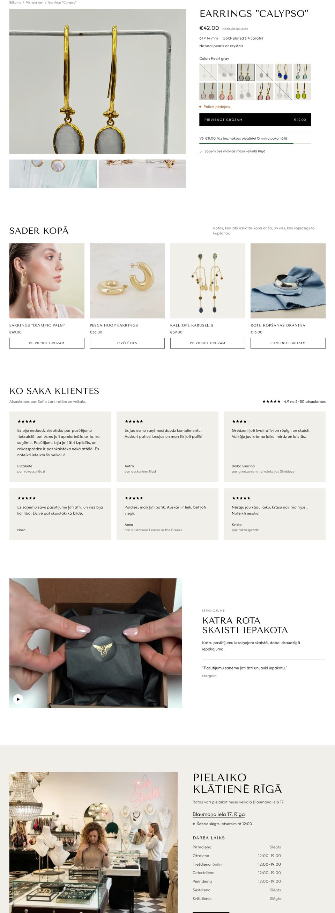

# Sofia Lark product page: theme sections

The product page layout from [`../product-page/`](../product-page/), built for the store's Impulse 9 theme as its **default product template**. Every product uses it as it is, with no setup per product, collection or metafield. Each part fills itself from data the store already has, and any part with nothing to show is left out.

These are renders of real products (photos, prices, stock and descriptions as they are today) inside the live header and footer: a brooch with one photo, a bracelet, an adjustable ring and a Kalliope earring.

## What every product gets, and where it comes from

The catalogue was measured first: 278 published products, 246 of them single-variant and 151 with one photo. The layout was then built and tested against all 278 (see *How it was checked*).

| Part of the page | Source | Products that get it today |
| --- | --- | --- |
| Photographs | The product's media. With fewer than four photos of its own, its variant photos fill in. A last photo that would sit alone in a half-width slot takes the full width. | all (151 show one photo) |
| One line under the title | The description's first plain line, when it reads like a summary ("Zeltītas bronzas auskari ar dabīgām saldūdens pērlēm"). The `custom.subtitle` metafield wins when filled. | 65 |
| Key facts under the price | The description, read by `snippets/sl-product-facts.liquid`, which picks up four things:<ul><li>`Label: value` lines (Izmērs, Garums, Materiāls, Size, Material, …).</li><li>The Kalliope headings: Materiāli, Roku darbs, Rotas kopšana.</li><li>A short first line naming the metal.</li><li>The description's claims: does not change colour in water, hypoallergenic, handmade in Greece.</li></ul> | 275 |
| Colour or variant picker | Photo tiles when every value of an option has its own photo, otherwise words. No option names need setting. Sold-out values are faded and struck through before anyone clicks. | 25 tiles, 7 words |
| Stock line | The variant's inventory: "Palicis pēdējais" (one left), "Palikuši tikai 2" (only two left), or sold out with a "tell me when it's back" link. | all |
| Rating | Shopify's standard review metafields, which Judge.me fills. | the 5 with reviews |
| Size and materials tab | The same facts in full, under Latvian labels. | 275 |
| Care tab | The description's own care text (Kalliope), otherwise the section's text and the care cloth. | all |
| "Sader kopā" (goes well together) | A grid of cards with photographs. The pieces are the Search & Discovery app's complementary products; if there are none, Shopify's own recommendations for the product, fetched after the page loads. The care cloth always comes last. | all |
| Reviews | Six real Latvian reviews from the store's Judge.me account, as an even grid. Above them is the store's overall rating, read live from Judge.me (now 4,9 from 50 reviews). | all |
| Packaging film | The packing video that was a full-width background before, now framed beside its text, looping without its closing logo. | all |
| Shop in Rīga | The theme's `sl-store` section. On product pages it has a light stone background, so it stands apart from the black footer; elsewhere it stays black. | all |

## Files

| File | What it does |
| --- | --- |
| `templates/product.json` | The default product template, in this order: the product, "Sader kopā", reviews, the packaging film, and the theme's existing `sl-store`. |
| `sections/sl-product.liquid` | The product itself. The photos scroll while the buy box stays in place. The buy box holds the title, the one-line summary, app blocks (for example Judge.me stars), the price, key facts, the variant picker with stock, the button, the free-delivery meter, the three promises and the tabs. On phones there's a swipe gallery and a sticky add-to-cart bar. |
| `sections/sl-product-pair.liquid` | "Sader kopā": complementary products, or Shopify's recommendations, then the care product, as cards. Single-variant pieces can be added to the cart in place. |
| `sections/sl-quote.liquid` | Up to six real reviews as equal cards, each with its stars, plus the overall Judge.me rating. On phones the cards are a row you swipe. |
| `sections/sl-packaging.liquid` | The packaging film in a 4:3 frame, with a pause button. It plays silently while on screen, and with reduced motion only when pressed. It uses a video uploaded to Shopify when one is chosen, otherwise the YouTube link (looping at 14 s, before the logo). The cover picture is in the store's Files and shows until the film plays. |
| `snippets/sl-product-facts.liquid` | Reads size, material, claims and care from a product. It uses only plain string operations, so each rule can be read and changed. |
| `snippets/sl-product-media.liquid`, `snippets/sl-pair-card.liquid` | One gallery square; one "Sader kopā" card. |
| `assets/sl-product.css`, `assets/sl-product.js` | Styles and behaviour. Without the script, the form still adds the chosen variant to the cart. |

## Preview and install

The files are already on an unpublished copy of the live theme, **"Impulse – jaunā produkta lapa (priekšskatījums)"**. The copy was taken from the theme that is live now, "Impulse – kolekciju lapas (draft)". The live theme was not changed.

**Preview link:** <https://sofialark.com/products/earrings-calypso?preview_theme_id=209273651545>

After opening the link once, any product in the store can be browsed in the preview until the preview bar at the bottom is closed. Other examples:
- [a brooch](https://sofialark.com/products/kalliope-piespraude-gf1969b?preview_theme_id=209273651545)
- [a bracelet](https://sofialark.com/products/copy-aproce-3?preview_theme_id=209273651545)
- [a sold-out piece](https://sofialark.com/products/aproce-7?preview_theme_id=209273651545)

To publish it, go to *Online Store → Themes*, open the copy's *⋯* menu and choose *Publish*. Every product page changes at once. To go back, publish the previous theme again.

The copy was taken on 21 October 2026 at 18:51 and checked against the live theme again afterwards. The live theme's newest change is from 09:52 that day, and its recently changed files have the same checksums on the copy. The only differences are `templates/product.json` and the files added here.

Changes made to the live theme from now on (new sections, edited texts) won't reach the copy. Make them on the copy as well, or take a fresh copy and add the files again before publishing.

The copy also still holds `snippets/sl-pair-row.liquid` from the first version. Nothing uses it any more, and it can be deleted under *Edit code* (the store connection used here cannot delete theme files).

Products that use another template (`product.gift-card`, `product.high-variant`, `product.preorder`, …) keep it.

## The cart

- The theme's cart type is currently **page**. With a page cart, adding a piece shows a short confirmation under the button and the visitor stays on the page.
- If the theme is switched to **drawer**, the theme's own drawer opens instead. The section sends the same `ajaxProduct:added` event the theme listens for.
- The header cart badge updates either way.

## Product metafields

Eight product metafields exist in the store and were filled from the descriptions for 263 products: `custom.subtitle`, `length_mm`, `width_mm`, `plating`, `stone`, `care`, `water_resistant` and `hypoallergenic`. What was written, by which rule, and how to undo it is in [`../metafields/README.md`](../metafields/README.md).

For each fact, the page uses the first that exists:
1. the filled metafield;
2. what the description says;
3. for material and closure only, the older `custom.material` and `custom.earring_closure`.

Anything empty is left out, so every product looks complete whatever is filled. Some older metafields hold wrong values (Calypso's `custom.material` says "Juveliertērauds"), but they're only used where a description says nothing.

"Sader kopā" also reads the Search & Discovery app's **complementary products**. Filling those replaces Shopify's automatic recommendations with hand-picked ones.

## How it was checked

- **Theme Check** (`shopify theme check`): 0 offenses.
- **The whole template with and without metafields.** All 278 products rendered twice: once with the values now stored, once with none. Both give complete pages.
- **The facts parser, on all 278 published products.** The rules were first written as a Python prototype limited to what Liquid can do. The Liquid snippet gives identical results on **278 of 278** products.
- **The whole template, on all 278 products.** Each was rendered with LiquidJS and Shopify-style filters from the store's public `products.json`, and all 278 rendered without an error.
- **In a browser**, inside a saved copy of the live product page with the real `theme.css`, `theme.js`, header and footer, and with the cart and recommendations endpoints mocked.
  - **Products:** Calypso (12 colours, 5 sold out), a brooch, a bracelet, an adjustable ring, a Kalliope earring, and a sold-out necklace.
  - **Behaviour checked:**
    - Price, stock line, photo and `?variant=` follow the chosen colour.
    - Sold-out variants offer the notify link.
    - Adding to the cart updates the badge and the delivery meter.
    - "Sader kopā" swaps in Shopify's recommendations when there are any and keeps the care cloth when there are none.
    - Arrow keys move through the colours.
    - The phone bar appears after the button and steps aside at the footer.
    - No sideways scroll at 1440px or 390px, and no script errors.
- **On Shopify itself**, on the preview copy:
  - Every file on the copy has the same checksum as this folder.
  - Products were rendered at 1440px and 390px: Calypso, the Kalliope brooch, ring and earrings, a bracelet and a sold-out bracelet.
  - Every page has all five sections, no sideways scroll and no script errors from these files.
  - All "Sader kopā" photographs load at once.
  - The reviews show the live rating "4,9 no 5 · 50 atsauksmes".
  - Calypso's 5 sold-out colours are struck through.
- **The packaging film.** YouTube refuses to play videos for the server these checks ran on, so the film itself could not be watched there; the cover picture showed instead. The script was checked against a stand-in for YouTube's player:
  - It starts when the film is on screen.
  - It goes back to the start at 14 s.
  - Pausing holds, even after scrolling away and back.
  - With reduced motion, it waits for the play button.

  
